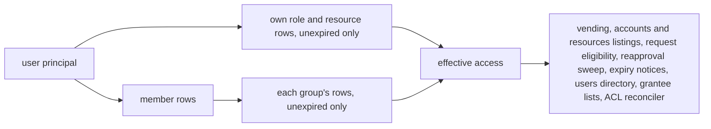

Since 2026-08-17 the portal decides every access question from one DynamoDB table, `Access`, in which grants are stored exactly as an admin granted them: a principal (a user or a group) to a target (a role in an account, or a private-network resource). A user's effective access is their own unexpired rows plus the rows of every group they belong to, and that union is computed in exactly one module that every reader calls. Absence is default-deny, a request never confers access, and a preference can never become a grant. This page summarizes the model; the row-level rules and lifecycles live in the deployment README, and [[Architecture]] shows where the vend itself happens.

## One table

| PK `principal` | SK `target` | Attributes | Meaning |
| --- | --- | --- | --- |
| `user#<sub>` or `group#<groupId>` | `role#<account>#<roleName>`, `resource#<resourceId>`, `plugin#<pluginId>#<account>#<user\|admin>` or `share#<shareId>` | `grantedBy`, `grantedAt`, `expiresAt?`; on user rows `expiringSeen?`, `expiredSeen?` and `expiryLoggedAt?`; share rows also carry `ttl` | A grant to that principal. A `plugin#` row authorizes only when `pluginAccess.ts` finds its binding available |
| `sharedef` | `share#<shareId>` | owner, `label`, `port`, `siteId`, `expiresAt`, `ttl` | A dev share's definition. Not a user or group, so never anyone's access |
| `user#<sub>` | `member#<groupId>` | `addedBy`, `addedAt` | Group membership |
| `user#<sub>` | `pref#role#<account>#<roleName>` and other `pref#` keys | `profileName?`, `roleLabel?`, the auto-vend star; also the `pref#presence`, `pref#adminReview`, `pref#network` and `pref#notifications` rows | Per-user preferences. A different SK, so never a grant |

- `<sub>` is the Cognito `sub` for humans and the app client id for service users.
- The `byTarget` GSI (`target` to `principal`) answers "who holds X" for users and groups, and "who is in group g" via `member#<g>`.
- The Groups table keeps only `{groupId, name, description, createdAt, createdBy}`; a group's bundle and its members are Access rows. Nothing is materialized per member.
- The v1 `Grants` and `ResourceGrants` tables (per-user rows) were unread since v2 and left `DataStack` in 0.2.0.
- Requests are the conversation ("may I?"); Access is the answer. Approving a request writes an Access row; the request row itself grants nothing. The Audit and Revocations tables are never read for a decision.

Why v2 replaced v1 (materialized `viaGroup` rows could not express "held directly and via a group"): [Access model v2](Access-Model#access-model-v2--one-access-table-effective-access-computed).

## Effective access, computed once



`effectiveAccess(userId)` is the union of the user's direct rows and the rows of every group in their memberships. A row counts only while unexpired, whoever holds it (admin-granted group rows carry no expiry; a dev share's do). The function lives in `packages/infra-client/lambdacode/api/services/access.ts` (`effectiveAccess`, `effectiveFor`, `holdersOf`, `snapshot`) and every reader goes through it. Cost is one Query on the user's partition (grants, memberships and prefs in one page) plus one Query per group; the vending hot path (`effectiveFor`, via `effectiveForMany`) replaces the per-group Queries with one BatchGet of the (group, target) keys, so a vend is two reads. The `direct` and `viaGroups` labels the admin views show are derived at read time.

Losing access is a row delete, so a notice cannot ride on the row. Every mutation that can end access (a direct revoke, leaving a group, a bundle shrinking, a group, role or resource delete, a reapproval lapse) goes through `accessNotices.withAccessDiff`, which diffs each affected user's effective targets before and after and writes a Revocations notice only for what was really lost.

## Temporary grants and expiry

- An admin grant, a bulk grant or an approval can carry `durationHours` from fixed presets (1 hour to 30 days); omitting it means standing access. Re-granting an existing temporary grant extends it.
- An expired row is kept, not deleted. Vending denies it, audited as `EXPIRED` (distinct from `NO_GRANT`), it stops listing on the accounts page, and re-approval overwrites the row.
- In the request picker an expired grant no longer blocks (re-request = renewal) and an unexpired temporary one can be re-requested (an extension ask); only long-term access blocks a new request.
- The bell is two-phase: one notice when "expiring soon" (within the smaller of 24 hours and half the lifetime) and one for 7 days after expiry, with separate `expiringSeen` and `expiredSeen` flags.
- Resource grants follow the same lifecycle; the network closes on the reconciler's next pass.

Detail: [Temporary grants and expiry lifecycle](Access-Model#temporary-grants--expiry-lifecycle).

## Reapproval of standing access

A daily sweeper reviews standing grants (no `expiresAt`), role and resource rows alike, for users and for group bundles (one review per group and target, decided once for all members). Interval 12 months, grace 14 days. Approving a `REAPPROVAL` request re-writes the grant and restarts the clock; denying it revokes. Grace is experienced, not computed: auto-revocation happens only after a raised review sat open for the full 14 days, and is recorded as a denial by `system:reapproval` so the audit shows it was not a person.

Two raise-only yearly reviews ride the same sweep and are never acted on automatically: service users (deny deletes the service user) and admins (deny demotes from the `admins` group; refused for the last human admin). Pending role and resource reapprovals can carry usage counts from the audit log when the Requests page asks for them. Humans get a `lastSeenAt` presence stamp as a `pref#presence` row. Detail: [Periodic reapproval](Access-Model#periodic-reapproval-standing-access).

## Groups

A group is a bundle of roles and resources plus a member list, all as Access rows. Adding a member adds one `member#` row and the member inherits the whole bundle; removing them removes that row, and the loss diff decides the notice. A direct grant and group access are independent: revoking a direct grant never touches the group's promise, and a direct grant next to group access keeps its own expiry. Deleting a group pulls its grants from all members while direct or other-group access survives. The one surviving "never downgrade" rule: a temporary direct grant never overwrites a long-term direct one. Bulk revoke removes direct grants only; a pair held through a group is reported as skipped ("No direct grant to revoke"), never refused. Detail: [Group edge rules](Access-Model#group-edge-rules).

## Profile names and per-role preferences

The `~/.aws/credentials` profile name for a user and role is resolved by the API in one place (`services/profileNames.ts`, returned by `GET /accounts`) and the desktop writes exactly that string. Order: the user's own override; else the account's admin-set profile name, only when the user holds exactly one role in that account; else the role's admin-set name; else `<accountNumber>-<roleName>` slugged. Admin-set names are unique across the platform, case-insensitively. The override, the personal role label and the auto-vend star are `pref#role#...` rows: plain upserts that survive a revoke and can never create access. Detail: [Profile names](Access-Model#profile-names--one-resolved-name-per-user--role) and [Per-role preferences](Access-Model#per-role-preferences-are-their-own-access-rows).

## Service users

A service user is a Cognito app client with a secret using the OAuth `client_credentials` flow (scope `api/invoke`, tokens live one hour). Its token's `sub` is the client id, so its grants are ordinary rows under `user#<clientId>` and vending, listings, revocation and audit work unchanged. Every service user is an app admin, so each client secret is a full admin credential. Authentication also requires the ServiceUsers registry row to exist, so deleting one locks it out on its next request; the registry never decides grants. Cognito cannot re-show a secret, so rotation creates a new client behind the same name with the grants copied, and both work until the old one is removed. No caller can delete or demote the last human admin. Detail: [Service users](Runbooks-Service-Users#service-users--machine-access-to-the-api).

## Sub-pinning

Each target role's trust policy pins the audience and a role-scoped subject: the issuer mints `sub = "<account>/<role>/<userId>"` and the condition is `StringLike <issuer>:sub = "<account>/<role>/*"`. A leaked or replayed token therefore works against exactly one role in one account. Rollout order is load-bearing: `CredsStack` first (the pin is additive), then each target account's roles stack, then a vend per account. `lib/__tests__/target-account-stack.test.ts` asserts the condition. Detail: [Sub-pinning](Access-Model#sub-pinning--role-scoped-trust); the trust side is in [[Security Posture]].

## Invariants

From the repo's working rules:

- One `Access` table; grants are stored exactly as granted. For a principal, row presence equals permission; a user's principals are themselves plus the groups they are in.
- Effective access is computed in exactly one place, `services/access.ts`, and every reader goes through it. Never add a second place that decides access.
- Never materialize group access into per-user rows again.
- Never reintroduce per-user grant tables (the v1 Grants/ResourceGrants pattern).
- Preferences are `pref#` rows: a different SK, so they cannot create a grant.
- Anything that can end access goes through `accessNotices.withAccessDiff`.
- Tests seed `__tests__/helpers/fakeAccess.ts` (an in-memory Access table) instead of stubbing Query or Scan of the table by hand.
- Accounts and roles are registered by an admin (CDK, admin API or admin UI); there is no self-service flow to add them.

## Data model — twelve tables (in `DataStack`)

Kept in a **separate stack** from the compute so the durable data outlives any API
redeploy. Tables reference each other by id (no duplicated data):

| Table | Key(s) | Holds |
|---|---|---|
| **Accounts** | PK `accountNumber` | registered AWS accounts (`name`, `environment`, …) |
| **Roles** | PK `accountNumber` + SK `roleName` | the assumable roles; **`roleArn` lives here** (single source of truth) |
| **Access** | PK `principal` + SK `target`, `byTarget` GSI | **access model v2 (2026-08-17)** — grants exactly as granted: `user#<sub>`/`group#<id>` → `role#<acct>#<name>`/`resource#<id>` (attrs `grantedBy`, `grantedAt`, `expiresAt?`, seen flags), memberships `user#` → `member#<groupId>`, per-role prefs `user#` → `pref#role#…`. Effective access = own unexpired rows ∪ rows of every group the user is in — computed by `services/access.ts` (`effectiveAccess`/`effectiveFor`/`holdersOf`/`snapshot`), the ONE place that rule lives |
| **Requests** | PK `requestId` | access requests awaiting/holding a decision. `byUser` GSI = "what have I asked for?", `byStatus` GSI = the admin queue |
| **Audit** | PK `eventId`, `byUser` (subject) + `byActor` + `byDay` GSIs, TTL `expiresAt` | append-only activity log: one primary row per action (actor, action, subject, target, outcome, reason) written by the service that performs it, plus derived per-user rows (`access.gain` / `access.lose`) the access diff writes for group, cascade and bulk changes; rows from before the general log (vend-only) are read through an adapter; **never read for an access decision**; retention `audit.retentionDays` (default 400) past the 12-month review |
| **Groups** | PK `groupId` | group identity only (`name`, `description`, `createdAt`, `createdBy`); a group's bundle and members are Access rows (`group#<id>` → targets, `user#` → `member#<id>`). Nothing is materialized per member |
| **Resources** | PK `resourceId` (uuid) | the network-resource catalog (Epic 4): what exists on the private network — account, `cidr` + `ports` (the ACL destination), display `dnsName`, connection instructions. Registering one grants nobody anything |
| **ServiceUsers** | PK `clientId` | registry of machine identities (M2M app clients): `name`, `createdAt/By`, `lastUsedAt`, rotation state (`previousClientId` on the current row / `retiredInto` on a replaced one). Auth requires the row to exist (delete = lockout on the next request), but it **never decides grants** — a service user's grants are ordinary Access rows under `user#<clientId>` (see "Service users" below) |
| **Revocations** | PK `userId` + SK `noticeId` (timestamp-first), TTL `ttl` | revoked-access notices for the activity bell. Expiry notices ride as seen-flags on still-existing grant rows, but losing access is a row delete — so every mutation that can end access (direct revoke, leaving a group, a bundle shrinking, group/role/resource delete, reapproval lapse) goes through `accessNotices.withAccessDiff`, which diffs each affected user's active targets before/after and writes a best-effort notice here only for what was really lost — and, since the activity log, one for what was really gained (`change: GRANTED`), except when the gain answers the person's own request (they get the decision instead). Served by `GET /notifications/revocations` (+ `/seen`); **never read for an access decision**; 30-day TTL |
| **PluginCatalog** | PK `pluginId` | deployment-written records of the installed plugins (Epic 5): revision, enabled flag, bound accounts, declared permissions, tombstoned or not — read by plugin discovery, the plugin authorizer and `pluginAccess.ts`, **never user grants** (those are `plugin#` rows in Access). Always present, feature on or off; no catalog record = no plugin grant authorizes |

**For a principal, row presence = permission for that principal; a user's
principals are themselves + the groups they are in.** Absence is default-deny
(new users have nothing). Vending asks `effectiveFor(user, role#…)`, then
resolves the ARN from the Roles catalog (falling back to the conventional ARN
if a role isn't catalogued yet). Users live in **Cognito**, not a table —
identity is the verified JWT, not a DB row.

**Access vs Requests:** Access is the *answer* ("may this user assume this
role?"); Requests is the *conversation* that leads to it ("may I?"). A request
never confers access — approving one writes an Access row, and Access is the
only thing vending reads. Writing a request can't accidentally grant anything.

> **Scale note:** `byStatus` partitions on a three-value key (`PENDING`/
> `APPROVED`/`DENIED`), so every pending request shares one partition. Fine at
> tens of rows (the queue drains as admins decide), but shard the key
> (e.g. `PENDING#<n>`) before request volume makes it hot.

### Access model v2 — one access table, effective access computed

**Built and cut over 2026-08-17** with a one-off migration script. The v1
Grants/ResourceGrants tables stayed deployed but unread until 0.2.0 removed
them (0.1.18 first dropped every other stack's reference to them, because
CloudFormation refuses to delete an export a deployed stack still imports —
upgrade through 0.1.18, never past it in one step).

Why: v1 materialized group access as ordinary Grants/ResourceGrants rows tagged
`viaGroup`, so one row must express three facts (held directly · held via
group(s) · both) and every mutation needs bespoke reconciliation
(`applyGroupGrants` skip/overwrite, `removeGroupGrants` re-tag via "coverage
by other groups", revoke hand-over). The state "direct AND via group" was
unrepresentable — revoking a direct grant deleted access a group still
promised (seen live 2026-08-17).

Design — grants are stored **exactly as granted**, in ONE table (`Access`):

| PK `principal` | SK `target` | attrs | meaning |
|---|---|---|---|
| `user#<sub>` \| `group#<groupId>` | `role#<acct>#<roleName>` \| `resource#<resourceId>` \| `plugin#<pluginId>#<acct>#<user\|admin>` \| `share#<shareId>` | `grantedBy`, `grantedAt`, `expiresAt?`, (user rows: `expiringSeen?`, `expiredSeen?`, `expiryLoggedAt?`; share rows: `ttl`) | a grant to that principal (a `plugin#` row authorizes only through `pluginAccess.ts`) |
| `sharedef` | `share#<shareId>` | owner, `label`, `port`, `siteId`, `expiresAt`, `ttl` | a dev share's definition — not a principal, so never anyone's access |
| `user#<sub>` | `member#<groupId>` | `addedBy`, `addedAt` | group membership |
| `user#<sub>` | `pref#role#<acct>#<roleName>`, `pref#presence`, `pref#adminReview`, `pref#network`, `pref#notifications` | `profileName?`, `roleLabel?`, … | per-user preferences (their own rows — a preference write can no longer touch a grant, by construction) |

GSI `byTarget` (`target` → `principal`) answers "who holds X" (users AND
groups; groups expand to members via `byTarget` on `member#<g>`) and "who is
in group g". The Groups table keeps only `{groupId, name, description,
createdAt, createdBy}` — a group's bundle and members are rows here.

**Effective access** = `direct(user) ∪ ⋃ grants(group) for group in
memberships(user)`; a row counts only while unexpired, whoever holds it
(admin-granted group rows carry no expiry; a dev share's group rows do). ONE function (`access.effectiveAccess(userId)`) computes it and every
reader uses it: vending (`credentialsService`), `/accounts`, `/resources`,
request eligibility, the reapproval sweep, expiry notices, the users
directory, grantee lists, and the ACL reconciler. Cost: 1 Query on the user's
PK (grants + memberships + prefs in one page) + one Query per group they are
in (single digits); the vending hot path (`effectiveFor` → `effectiveForMany`)
replaces the per-group Queries with one BatchGet of (group, target) keys — two reads.

Invariant, restated: **for a principal, row presence == permission for that
principal; a user's principals are themselves + the groups they are in.**
Absence is still default-deny; a request row never confers access; writing a
preference never creates a grant (different SK).

What disappeared: `applyGroupGrants`/`removeGroupGrants` (+ resource twins),
coverage-by-other-groups, `groupCoverage.ts`, the `viaGroup` tag on rows
(`direct`/`viaGroups` are derived at read time and returned by the grantee /
per-user endpoints), and in 0.2.0 the v1 Grants and ResourceGrants tables
themselves.

Test helper: `lambdacode/api/__tests__/helpers/fakeAccess.ts` is an in-memory
Access table over aws-sdk-client-mock (install right after `ddbMock.reset()`;
table-specific stubs declared afterwards still win). Seed rows instead of
stubbing Query/Scan when a test needs access state.

Revocation notices: a delete only ends access when nothing else covers the
target, so notices are computed at mutation time by diffing effective access
before/after for the affected users (direct revoke, membership removal,
bundle change, group delete, catalog cascades) — `accessNotices.withAccessDiff`.

Migration (a one-off idempotent script, deleted with the v1 tables): Grants rows
without `viaGroup` → `user#`+`role#` rows (attrs copied); ResourceGrants
likewise → `resource#`; Groups: `roles`/`resources` → `group#` rows, `members`
→ `member#` rows; rows tagged `viaGroup` are dropped when that group still
bundles the target for that member, else converted to a direct row (nobody
loses access). Preferences on Grants rows → `pref#` rows.

### Temporary grants & expiry lifecycle

Resource grants follow the same lifecycle as role grants below: same two-phase
bell notices (via `GET /resources/expiry` + seen flags on the Access
row), same renewal/extension asks through the bell, and the same 12-month
reapproval sweep of standing direct grants (a resource-reapproval denial
revokes the direct resource grant; the network closes on the reconciler's next
pass).

An expired grant row is **kept, not deleted**: vending denies it (audited as
`EXPIRED`, distinct from `NO_GRANT` — an expiry denial is expected, not
suspicious), it stops listing on the accounts page, and re-approval simply
overwrites the row. In the request picker an *expired* grant no longer blocks
(re-request = renewal) while an *unexpired* temporary one can also be
re-requested (= extension ask) — approval overwrites either way; only
long-term access blocks a new request. The expiry bell is two-phase: a grant
alerts once when "expiring soon" (within min(24 h, half its lifetime), so a
1-hour grant alerts at 30 min, not at issue) and again for 7 days after it
expires, with separate `expiringSeen`/`expiredSeen` acknowledgement flags.

### Periodic reapproval (standing access)

The daily sweeper covers **standing** grants — role AND resource rows:
long-term (no `expiresAt`), both a user's own Access rows and, since
2026-08-20, **group bundle rows** (one review per group×target, decided once
for all members; a lapsed group target is revoked from the group, and the
group's *last* target takes the whole group with it).
Interval 12 months, grace 14 days, both from `requestsService`. Approving a
`REAPPROVAL` request re-writes the grant (or re-stamps the group row), which
resets `grantedAt` — the clock restarts. **Denying a REAPPROVAL revokes the
standing grant** (unlike denying an ACCESS request, which changes nothing).
The sweep is stateless and idempotent: one open request per grant, and grace
is **experienced, not computed** — auto-revocation happens only after a
raised review sat open for the full 14 days (so a category newly entering
the sweep gets a visible review first, never a surprise revoke on deploy),
always via a denial recorded as `system:reapproval` so the audit shows it
wasn't a person.

Two **raise-only** yearly reviews ride the same sweep (2026-08-20) — the
sweep never acts on these by itself; the pending request just waits:

- **Service users** (`kind: SERVICE_USER`, clock = last approved review or
  creation): approve stamps `reviewedAt`; **deny DELETES the service user**
  (secret dead on its next call, grants gone). Never auto-deleted on lapse —
  an unattended review must not kill a working automation.
- **Admins** (`kind: ADMIN`, clock = the `pref#adminReview` stamp on the
  admin's principal, written on approval — Cognito keeps no group-add
  timestamp, so the first sweep raises one per current admin): **deny
  demotes** from the admins group (refused for the last human admin — the
  request stays pending). Denying a service-user review keeps its DENIED row
  (the delete cascade clears pending rows only), so the decision stays on
  record; a deleted or shrunk group likewise clears its pending reviews so
  no ghost sits in the queue.

Pending role/resource reapprovals also carry **usage** (`countRoleUsage`
over the audit log's 400-day retention): "used N× this year" / "never used
this year" — decision support in the queue chip and dialog. Computed only
when the Requests page asks (`?usage=1`) and best-effort per row — the
bell's 60 s poll of the same endpoint never pays the audit walk, and a
failed lookup can't 502 the queue.

Humans get a `lastSeenAt` presence stamp on authenticated calls
(`pref#presence` row on the Access table — a pref SK, so it can never be a
grant; machines already had `lastUsedAt`). Throttled to one write per user
per 5 min per container; honest to within ~12 h even for parked sessions,
since the 12-hour refresh-token cap forces a real sign-in at least that
often. The Users detail panel shows it; tracking starts 2026-08-20, so
older activity reads "No activity recorded yet".

### Profile names — one resolved name per user × role

`~/.aws/credentials` profile names matter (cdk.json, scripts), so since
2026-08-18 they are resolved by the API in ONE place —
`services/profileNames.ts`, used by `GET /accounts` (`profileName`,
`profileSource`, `suggestedProfileName` per role) — and the desktop writes
exactly that string (no project prefix, no re-slugging):

1. the user's own override (`pref#…profileName`, set from the role card /
   credentials dialog; "↺ reset" clears it),
2. the account's admin-set `Accounts.profileName` — only when the user holds
   exactly ONE role in that account (two roles can't share a profile),
3. the role's admin-set `Roles.profileName` (its default),
4. `<accountNumber>-<roleName>` slugged (the pre-2026-08 default).

Admin-set names (account-level AND role-level) must be **unique across the
platform, case-insensitively** — enforced on create/update
(`adminService.assertProfileNameFree`, 409) because they all land in the same
credentials file. Format: `^[A-Za-z0-9][A-Za-z0-9_.-]{0,63}$` (routes
validate; `''` clears). Set them in Admin → Accounts (account panel row
"Profile name", role panel row "Profile name").

### Per-role preferences are their own Access rows

The profile-name override, the personal role label and the auto-vend star are
`user#<sub>` → `pref#role#<acct>#<role>` rows on the Access table. A
preference row is not a grant row (different SK — readers only treat
`role#`/`resource#` targets as grants), so a preference write can never
create access, by construction; the writes are plain upserts. Preferences
survive a revoke (harmless UI state; a re-grant finds them again).

### Group edge rules

None left to remember: a direct grant and group access are independent rows.
Leaving a group removes one membership row; the user keeps anything they hold
directly or through another group, and the loss diff decides the notice. A
direct grant next to group access keeps its own expiry, and revoking it never
touches the group's promise (the bug of 2026-08-17 that motivated v2). The
"never downgrade" rule survives only in its narrow form: a temporary direct
grant never overwrites a long-term direct one.

## Cross-account: trust a second account

Deploy `RolesStack` into the target account (B):

```bash
aws sso login --profile sandbox-b
npx cdk bootstrap --profile sandbox-b aws://<ACCOUNT_B>/eu-central-1
npx cdk deploy Roles-<ACCOUNT_B> --profile sandbox-b   # outputs RoleArn-<roleName> per role
```

The account must be listed in `rolesByAccount` (that's what creates the
`Roles-<account>` stack); the deployed CloudFormation name stays `RolesStack`.

> The role names are fixed (the Roles catalog stores their ARNs), so
> CloudFormation can never replace a role **in place** — the replacement would
> collide with the existing name. If a `RolesStack` deploy fails with an
> "already exists" error (e.g. after roles moved in code), destroy the stack and
> deploy it fresh; the role ARNs come back identical, so the catalog and grants
> in account A are unaffected.

> **Session length.** Target roles are created with
> `MaxSessionDuration` at the STS max (12 h), so the admin-set per-role
> session length in the app (900–43200 s, default 3600) is the effective
> limit; `TargetRoleSpec.maxSessionDuration` hard-caps a role lower in IAM if
> wanted. Roles deployed before 2026-08-26 still carry the old 1 h cap —
> picks longer than 1 h fail against them (the admin Test button and the
> vend/console errors say so) until their `Roles-<account>` stack is
> redeployed. That redeploy is an in-place IAM update, no role replacement.

Then register the account + role via the admin API (or seed the Roles/Access rows)
and `POST /credentials` for it — `aws sts get-caller-identity` with the returned
creds reports `<ACCOUNT_B>`. The issuer URL derives from
`PROJECT.issuer.domainName` in `config/project.ts` — trust can't drift from
the issuer, and there is deliberately no override knob. Because that host no longer
changes when CredsStack is rebuilt, `RolesStack` only needs redeploying when the
roles/accounts here change — not on every issuer/CredsStack recreate as before.

### Sub-pinning — role-scoped trust

Each target role's trust policy pins BOTH the audience and a role-scoped
subject: the issuer mints `sub = "<account>/<role>/<userId>"` and the trust
condition is `StringLike <issuer>:sub = "<account>/<role>/*"`. A leaked or
replayed token therefore works against exactly one role in one account —
without the pin, every role in every target account trusts the same
issuer+aud and any minted token could assume all of them.

**Rollout/redeploy ORDER (load-bearing):**

1. **CredsStack first** (tokens gain the scoped sub; aud-only trust policies
   still accept them — the pin is additive).
2. **Then RolesStack per target account** (in-place trust update, no role
   replacement):

   ```bash
   npx cdk deploy Roles-<ACCOUNT_B> --profile <account's profile>
   ```

3. **Vend end-to-end per account** afterward (role card → Get credentials →
   `aws sts get-caller-identity`, or the admin Test button).

Reversed order breaks vending in that account (pinned trust rejects
old-format tokens) until CredsStack ships.
`lib/__tests__/target-account-stack.test.ts` asserts the condition so it
can't silently regress.
