`@fntio/infra-client` is a self-hosted AWS access portal delivered as one npm package: CDK stacks and constructs, prebundled Lambdas, and the compiled Angular web app. A consumer writes a small CDK app, points it at a typed config object, and deploys into their own AWS accounts. Users sign in under the consumer's own domain, receive short-lived credentials for the accounts and roles they are allowed, and optionally reach private VPC resources over a built-in VPN. This page maps the deliverables, the stacks, the credential vending flow, the data model, the API surface, and where the code lives. Access decisions are covered in [[Access Model]], the VPN in [[Private Network]], and trust and hardening in [[Security Posture]].

## Three deliverables

| Deliverable | Repo path | Ships as |
| --- | --- | --- |
| The package `@fntio/infra-client` | `packages/infra-client/`, plus the `frontend/` build copied into `assets/web` at pack time | An npm tarball (a registry at general availability): compiled `dist/`, one prebundled folder per Lambda under `assets/`, the built web app, `openapi.yaml`, the package README |
| The desktop client | `desktop/` | One public signed Electron binary for all deployments, attached to each GitHub Release by the `release` workflow (`desktop-build` cuts test builds). Not in the package |
| FNTIO's own deployment | `infra/` | `config/project.ts`, `bin/app.ts`, the internal-only PipelineStack, TestbedStack and DemoVpcStack, the onboarding import CLI, the ops runbooks. Not in the package; moves to a private repo before the source-available release |

Also in the repo but not shipped: `samples/` (five consumer-voice CDK apps the package README's examples derive from) and `.github/workflows/` (`release.yml`, `desktop-build.yml` and the repo automation). Consumer documentation is the package README, which ships inside the tarball: [What is in the tarball](https://github.com/FNTIO/aws-infrastructure-client/blob/main/packages/infra-client/README.md#what-is-in-the-tarball).

## Stacks

Nine CDK stacks. The hub account hosts the portal; each workload account gets a trust stack and, optionally, a VPN connector per VPC. The package exports the hub stacks, `TargetAccountStack` and `ConnectorStack`; `PipelineStack` and `TestbedStack` live in `infra/lib/` and are FNTIO-only.

| Stack | Deploys to | Holds |
| --- | --- | --- |
| `DataStack` | hub | The DynamoDB tables (below). Kept apart from compute so data outlives any API redeploy |
| `CredsStack` | hub | The Cognito user pool (Essentials plan, choice-based sign-in, the `admins` group, the `api` resource server); the `OidcIssuer` construct (KMS RSA signing keys, with the discovery document and JWKS as static S3 objects behind CloudFront on the stable issuer host); the `VendingApi` construct (Express on Lambda, Node 22, behind a `LambdaRestApi` proxy that also serves the public `GET /.well-known/infra-client` discovery document); the daily `ReapprovalSweeper` Lambda; the API web ACL |
| `WebStack` | hub | The Angular app in a private S3 bucket behind CloudFront (Origin Access Control), SPA deep-link rewrite, the SPA's Cognito app client and the custom auth domain. Outputs `WebUrl` |
| `WebCertStack` | hub, us-east-1 | What CloudFront only accepts from that region: the issuer certificate (always), the web and auth-domain certificate (with `web`), the CloudFront WAF web ACLs. Never deployed alone; a dependency of `CredsStack` and `WebStack`, so it exists on every deployment |
| `TargetAccountStack` | each workload account | An IAM OIDC provider trusting the issuer plus one fixed-name role per `rolesByAccount` entry. One app-level stack per account; the deployed CloudFormation name is `RolesStack` |
| `NetworkStack` | hub | The VPN control plane: Headscale on Fargate, one service per site, the key minters, the ACL reconciler. Manual deploy |
| `ConnectorStack` | each VPC's account | One per target VPC: the tailnet connector, that account's SG-manager and in-VPC resolver. Manual deploy |
| `PipelineStack` | hub | The GitHub OIDC provider and deploy role CI uses. Deployed manually, once. FNTIO-only |
| `TestbedStack` | hub | Temporary VPN acceptance test bed. FNTIO-only |

In FNTIO's deployment, pushing `main` deploys `DataStack`, `CredsStack` and `WebStack` (with `WebCertStack` as a dependency); the network stacks, `PipelineStack` and the target-account stacks are hand deploys. Details: [Infra: nine CDK stacks](Architecture#infra--nine-cdk-stacks-binappts). Subsystems inside a stack are constructs in `lib/constructs/` (`OidcIssuer`, `VendingApi`, `AppFunction`, `AppTable`, `Monitoring`, `TailnetConnector`, `SgManager`, `TailnetResolver`, `WebAcl`, the web-identity helpers). A construct is a code unit, not a deployment unit, so the stack list above is complete.

## Credential vending

Identity is proven cryptographically: the API mints a KMS-signed OIDC web-identity JWT and exchanges it with STS, so no long-lived keys exist anywhere. The target role trusts the issuer URL, never the hub account directly, and its trust condition pins both the audience and a role-scoped subject.

```mermaid
sequenceDiagram
    actor U as User
    participant A as Web or desktop app
    participant C as Cognito
    participant P as API Lambda (Express)
    participant K as KMS
    participant S as STS
    participant I as Issuer (S3 + CloudFront)
    U->>A: Sign in
    A->>C: In-app sign-in (password, passkey, email OTP)
    C-->>A: ID token
    U->>A: Get credentials for an account and role
    A->>P: POST /credentials with Bearer ID token
    P->>P: requireAuth verifies the token
    P->>P: effectiveFor(user, role target) decides, Roles table resolves the ARN
    P->>K: kms:Sign a web-identity JWT, sub = account/role/userId
    P->>S: AssumeRoleWithWebIdentity(roleArn, JWT)
    S->>I: Fetch discovery document and JWKS (static, cached)
    S-->>P: accessKeyId, secretAccessKey, sessionToken
    P->>P: Append an activity row (vend or denial)
    P-->>A: Credentials (or 403)
    A-->>U: Credentials (the desktop writes the resolved profile to ~/.aws/credentials)
```

`POST /accounts/{account}/roles/{role}/console` follows the same path and ends in a short-lived console sign-in URL. The Audit table records every vend and denial but is never read to make a decision. The issuer is static: the deploy writes the discovery document and JWKS into a bucket (`Custom::OidcIssuerDocuments`) and nothing runs when STS fetches them.

## Data model

Twelve DynamoDB tables in `DataStack`. Tables reference each other by id; nothing is duplicated.

| Table | Key | Holds |
| --- | --- | --- |
| Accounts | `accountNumber` | Registered AWS accounts (name, environment, admin-set profile name) |
| Roles | `accountNumber` + `roleName` | The assumable roles; `roleArn` lives here, the single source of truth |
| Access | `principal` + `target`, GSI `byTarget` | Access model v2: grants exactly as granted (`user#` or `group#` to `role#` or `resource#`), memberships (`member#`) and per-role preferences (`pref#`) |
| Requests | `requestId`, GSIs `byUser` and `byStatus` | Access requests awaiting or holding a decision; `byStatus` is the admin queue |
| Audit | `eventId`, GSIs `byUser` (subject), `byActor` and `byDay`, TTL | Append-only activity log — every action that changes or uses access, one row each, plus per-user derived rows for group, cascade and bulk changes; never read for an access decision |
| Groups | `groupId` | Group identity only; a group's bundle and members are Access rows |
| Resources | `resourceId` | The private-network catalog: account, `cidr` + `ports`, display `dnsName`, connection instructions. Also holds the reconciler status sentinel |
| ServiceUsers | `clientId` | Registry of machine identities and their rotation state; never decides grants |
| Revocations | `userId` + `noticeId`, TTL | Access-change notices for the bell — revocations and unasked-for grants; 30-day TTL |
| PluginCatalog | `pluginId` | Deployment-written records of the installed plugins: revision, enabled flag, bound accounts, declared permissions, tombstoned or not; read by plugin discovery, the plugin authorizer and `pluginAccess.ts`, never user grants. Always present, feature on or off |

Users live in Cognito, not a table. Absence of an Access row is default-deny. Column-level detail: [Data model: twelve tables](Access-Model#data-model--twelve-tables-in-datastack); the decision rules are in [[Access Model]].

## API

One Express app, reachable through the portal's CloudFront distribution under `/api/*` and directly on API Gateway. The contract is `packages/infra-client/openapi.yaml` (OpenAPI 3.1, ships in the package): 76 paths, 98 operations. A drift test walks the mounted routes and fails when a route is missing from the spec or documented but gone; request and response shapes are maintained by hand. The Postman collection is generated from the spec.

- Authentication: every route except `GET /health` and `GET /.well-known/infra-client` takes `Authorization: Bearer <token>`, either a Cognito ID token (humans; admin routes need the `admins` group claim) or a `client_credentials` access token with the `api/invoke` scope (service users, who are all app admins).
- User routes (36 operations): Health; Access (what I may assume, vend, console URL, expiry notices); Requests (raise and list my own, acknowledge decisions); Preferences (profile name, role label, auto-vend star, network, notifications); Network (sites, device key, dev shares and their directory); Resources (what I can reach); Notifications (access changes); Plugins (which plugin pages I may open).
- Admin routes (62 operations): setup and branding; accounts and roles, and their display order; grants, including bulk; users (directory, invites and sign-up links, cascades, MFA reset); service users (create, rotate, retire); groups and members; the request queue (approve, deny); the resource catalog and resource grants; network topology, dev shares and sync; plugins (catalog, per-plugin grants); the activity log and the access report.
- Conventions: JSON errors `{ "message" }`, ISO-8601 UTC timestamps, no server-side paging (lists are returned whole and windowed client-side), duration presets from 1 hour to 30 days for temporary access.

Route contract: [openapi.yaml](https://github.com/FNTIO/aws-infrastructure-client/blob/main/packages/infra-client/openapi.yaml), drift-tested against the mounted routes. Consumer view: [HTTP API](https://github.com/FNTIO/aws-infrastructure-client/blob/main/packages/infra-client/README.md#http-api).

## Where the code lives

- `packages/infra-client/lib/`: the stacks (`data-stack.ts`, `creds-stack.ts`, `web-stack.ts`, `web-cert-stack.ts`, `network-stack.ts`, `connector-stack.ts`, `target-account-stack.ts`), `access-portal.ts` (`addAccessPortal`), `access-portal-hub.ts` (`AccessPortalHub`), `project-config.ts` (`ProjectConfig`), `network-validation.ts`, and `constructs/`.
- `packages/infra-client/lambdacode/`: `api/` (`app.ts`, `auth.ts`, `routes/`, `services/`, `__tests__/`: thin routers over framework-agnostic services, one file per resource); `network/` (`acl-reconciler.ts`, `keyminter.ts`, `sg-manager.ts`, `resolver.ts`, and `naming.ts`, the single home of every by-name contract); `issuer/` (the document publisher); `monitoring/` (the issuer canary); `reapproval/`; `firstadmin/`; `headscale-apikey/`; `plugins/` (the shared plugin authorizer and the catalog-record custom resource); `federation/` (the pre-sign-up trigger that links a federated sign-in to its invite).
- `frontend/`: the Angular app. `desktop/`: the Electron shell. `infra/`: FNTIO's deployment and runbooks. `samples/`: consumer apps.

Layout rationale: [Code layout](Architecture#code-layout).

### Public API

Everything a consuming CDK app needs is exported from the package root; deep imports into `dist/` are not part of the contract. The main exports: the `ProjectConfig` and `SiteConfig` types; `addAccessPortal(scope, props)` for the hub stacks; `AccessPortalHub.fromAttributes()` for cross-account stacks (issuer URL, control URLs, connector key minter and reconciler principal, all derived by name); `resolveSites()`; `TargetAccountStack` with the `InfraClientRoles` constants (`InfraReadOnly`, `InfraPowerUser`, `InfraFullAdmin`); `createIssuerProvider` and `webIdentityPrincipal` for hand-built roles; `ConnectorStack` with `TailnetConnector`, `SgManager` and `TailnetResolver`; the individual hub stacks; `WebAcl`; the by-name helpers. Constructs take CDK interface objects, never bare ARNs; ready-made stacks are the data boundary. `addAccessPortal` also accepts `webAssetPath` to serve a different build of this product's frontend.

Full export table: [Public API](https://github.com/FNTIO/aws-infrastructure-client/blob/main/packages/infra-client/README.md#public-api). Design rules: [Public construct API](Architecture#public-construct-api). Custom bundle: [Bring your own web build](https://github.com/FNTIO/aws-infrastructure-client/blob/main/packages/infra-client/README.md#bring-your-own-web-build).

## Code layout

Thin HTTP routers over framework-agnostic services — one file per resource, not
per endpoint. New route = add `routes/<x>.ts` + `services/<x>Service.ts`.

- `api/app.ts` — Express setup, request logging, `/health`, mounts routers, clean
  JSON 404/error handlers. Exports `handler = serverless(app)` **and** runs
  `app.listen(3000)` under `require.main === module` for local dev.
- `api/auth.ts` — `requireAuth` (verify Cognito ID token, set `req.userId` +
  `req.groups`) and `requireAdmin`.
- `api/routes/` — `accounts`, `credentials`, `requests`, `preferences`, `network`, `resources`, `notifications`, `plugins`, `admin`.
- `api/services/` — `accountsService` (user-scoped reads), `credentialsService`
  (vend), `adminService` (account/role catalog reads + writes), `grantsService`
  (assign/revoke/list grants), `usersService` (directory list + Cognito user
  admin: create/invite, update email + admins group, delete with grant cascade),
  `requestsService` (raise/list access requests, the requestable catalog, and
  approve → **`grantsService.assignRole`** / deny),
  `auditService` (append/read the activity log; the actor comes from `actorContext`, bound per request), `groupsService` (role/resource
  bundles + membership as Access rows; `access.ts` computes effective access,
  `accessNotices.ts` the loss diff → notices), `reapprovalService` (the daily
  standing-grant sweep — raise reapproval requests / auto-revoke past grace),
  `resourcesService` + `resourceGrantsService` (the network catalog and its
  grants), `sharesService` (dev shares), `networkStatusService` (sites,
  topology, sync), `preferencesService`, `revocationsService` (the bell's
  notices), `serviceUsersService`, `accessReportService`, and the plugin side
  (`pluginCatalog`, `pluginAccess`, `pluginGrantsService`,
  `pluginDiscoveryService`); token checks in `tokenVerifier` (shared with the
  plugin authorizer); shared error types in `httpErrors`.
- `api/__tests__/` — Jest, one suite per source file (mocked AWS + supertest).
- `reapproval/handler.ts` — the scheduled (daily) Lambda entry point that calls
  `reapprovalService.sweepReapprovals()`; no HTTP surface, separate from the
  Express app.
- `issuer/publish.ts` — the `Custom::OidcIssuerDocuments` handler: at deploy
  time it reads every signing key's public key from KMS and writes the OIDC
  discovery document, the JWKS and a root page into the issuer bucket, which
  CloudFront serves on the stable custom domain
  (`issuer.portal.example.com`; host, zone and zone id come from the
  `issuer` block of `config/project.ts` — nothing is hardcoded). Nothing runs
  when STS fetches them. Key rotation: the JWKS publishes **every** key
  generation in `issuer.keyVersions`, so tokens signed by old and new keys
  verify while both are in flight. The published `iss` is always the fixed
  config value, never derived from a request. (Until 2026-09-08 this was a
  Lambda behind an API Gateway HTTP API — see "Issuer on S3 + CloudFront".)
- `monitoring/issuer-canary.ts` — once a minute (EventBridge, in the Monitoring
  construct) it fetches the public OIDC discovery document exactly the way STS
  does — full public DNS + TLS + HTTP — then follows its `jwks_uri` and
  requires the active signing key (`EXPECT_KID`) in the JWKS. Any failure mode
  that would break vending (deleted Route 53 record, broken cert, missing or
  stale objects, garbage response) makes the function **throw**; the alarm on its
  Errors metric emails the ops topic. No output on success — errors are the
  signal.

## Infra — nine CDK stacks (`bin/app.ts`)

- **`DataStack`** ([lib/data-stack.ts](https://unpkg.com/browse/@fntio/infra-client@latest/dist/lib/data-stack.js)) — the twelve tables above.
- **`CredsStack`** ([lib/creds-stack.ts](https://unpkg.com/browse/@fntio/infra-client@latest/dist/lib/creds-stack.js)) — account A: Cognito
  (+ `admins` group), an **`OidcIssuer`** construct (KMS RSA signing key(s) +
  the discovery document and JWKS as static S3 objects behind a CloudFront
  distribution on a stable custom domain — us-east-1 ACM cert from
  WebCertStack + Route 53 alias, so `iss` never drifts (host, zone and zone id
  come from the `issuer` block of `config/project.ts` — nothing is hardcoded
  in `creds-stack.ts`)), a **`VendingApi`** construct (the Express Lambda — Node 22;
  **read/write** on every table above (read-only on PluginCatalog),
  `kms:Sign`, Cognito user
  admin (`ListUsers`/`ListUsersInGroup` + `AdminCreateUser`/
  `AdminUpdateUserAttributes`/`AdminDeleteUser`/`AdminAddUserToGroup`/
  `AdminRemoveUserFromGroup`) **scoped to this pool's ARN** (the admin Users
  page), **no** `sts:AssumeRole`), and a `LambdaRestApi` proxy that also serves a
  public, unauthenticated `GET /.well-known/infra-client` discovery doc (project
  name + Cognito ids + issuer) the desktop app reads to self-configure. Receives the tables from `DataStack` via props. The pool is on the **Essentials** feature
  plan with **choice-based sign-in** — the first-auth factors (password, passkey/
  WebAuthn, email OTP) come from `PROJECT.loginMethods` in
  `config/project.ts`, so a deployment re-picks methods without stack-code
  changes.
  CredsStack also provisions a **`ReapprovalSweeper`** Lambda on a **daily
  EventBridge schedule** — it raises a reapproval request into the admin queue for
  standing (long-term, direct) grants past their 12-month mark and auto-revokes any
  left un-reapproved past the grace window.
  Hardening 2026-07-27: vend API stage throttle 25 rps / 50 burst; every Lambda
  gets 3-month log retention via the shared `AppFunction` construct.
- **`TargetAccountStack`** ([lib/target-account-stack.ts](https://unpkg.com/browse/@fntio/infra-client@latest/dist/lib/target-account-stack.js))
  — a **target** account (B): an IAM OIDC provider trusting account A's issuer
  + the assumable roles (one fixed-name `iam.Role` per `PROJECT.rolesByAccount`
  entry in `config/project.ts`, its trust built by `webIdentityPrincipal` —
  see "Public construct API" below). One app-level stack per configured
  account — `Roles-<account>` — all sharing the deployed CloudFormation name
  `RolesStack` (each lives in a different account, so the names never meet).
- **`WebStack`** ([lib/web-stack.ts](https://unpkg.com/browse/@fntio/infra-client@latest/dist/lib/web-stack.js)) — account A: the Angular
  web frontend (Epic 2) — private S3 bucket + CloudFront (Origin Access Control),
  SPA deep-link rewrite via a CloudFront Function, `BucketDeployment` with a
  `/*` cache invalidation. Always synthesized — synth throws "Web assets not
  found" when `frontend/dist` is missing, so `npm run build` in `frontend/`
  comes before ANY cdk command, even an API-only deploy or a bare
  `cdk bootstrap`. Outputs `WebUrl` / `DistributionDomain`. Also owns the SPA's
  Cognito app client (`USER_AUTH` + `preventUserExistenceErrors`; sign-in is
  the app's own `/login` page since 2026-08-11) and the Cognito custom auth domain. The
  Managed Login branding (`managed-login-branding.json`) is vestigial: the
  hosted pages no longer serve sign-in, and the login page's skin flows from
  the `branding` config block like the rest of the app.
- **`WebCertStack`** ([lib/web-cert-stack.ts](https://unpkg.com/browse/@fntio/infra-client@latest/dist/lib/web-cert-stack.js)) — account
  A, **us-east-1**: what CloudFront only accepts from that region — the
  issuer's certificate (always), the web + auth-domain certificate (when
  `web` is set) and the CloudFront WAF web ACL (when WAF is on, the default —
  see "Security posture"). Never deployed alone; rides along as a CredsStack
  + WebStack dependency, so it exists on every deployment.
- **`PipelineStack`** (`lib/pipeline-stack.ts`) — account
  A: the GitHub OIDC provider + `GithubDeployRole` that CI deploys with (see
  **CI/CD** below). Deployed **manually, once** — the pipeline can't create the
  role it logs in with. Outputs `DeployRoleArn`.
- **`NetworkStack`** ([lib/network-stack.ts](https://unpkg.com/browse/@fntio/infra-client@latest/dist/lib/network-stack.js)) — Epic 4
  Headscale control plane; deployed manually/on-demand.
- **`TestbedStack`** (`lib/testbed-stack.ts`) — Epic 4
  acceptance test bed, temporary. Verify from a tailnet-connected laptop:
  `curl http://<nginx task private IP>/` → nginx welcome page;
  `psql -h <DbEndpoint output> -U postgres testdb` (password in `DbSecretArn`).
  Aurora endpoints resolve publicly to the private IP, so no split-DNS is
  needed.
- **`ConnectorStack`** ([lib/connector-stack.ts](https://unpkg.com/browse/@fntio/infra-client@latest/dist/lib/connector-stack.js)) — one
  per target VPC; deployed manually. Also carries that account's SG-manager
  Lambda (see "Per-resource firewall automation").

Subsystems inside a stack live as **constructs** in
[lib/constructs/](https://unpkg.com/browse/@fntio/infra-client@latest/dist/lib/constructs/) — `OidcIssuer`, `VendingApi`,
the `web-identity.ts` helpers, plus `AppFunction`, `AppTable`, `Monitoring`,
`WebAcl`, `TailnetConnector`, `SgManager` and `TailnetResolver` (FNTIO's
`GithubDeployRole` lives in `infra/lib/constructs/`, outside the package). A construct is a code-organization unit, not a deployment
unit: everything in it still deploys as part of its stack, so the stack list
above is complete. The Cognito user pool and the `LambdaRestApi` deliberately
stay at stack level — `WebStack` plugs into both, and keeping them out of any
construct keeps their CloudFormation identities (and the cross-stack exports)
stable when the internals are refactored.

### Public construct API

The surface a consuming CDK developer sees once this ships as packages
(see [[Releasing]]). Runnable consumer-voice examples live
in [../samples/](https://github.com/FNTIO/aws-infrastructure-client/tree/main/samples/); design decisions recorded in the packaging
doc's "Construct API decisions" section. The rules:

- **Constructs take CDK interface objects** (`IVpc`, `IFunction`,
  `IPrincipal`, `IManagedPolicy`) — never bare ARNs/ids. Consumers with only
  a string use CDK's own `fromXxx()` escape hatches. **Ready-made stacks are
  the data boundary**: their props may be plain values (`vpcId`, account
  ids), since stack props exist before any scope does.
- **Quick + flexible path per feature.** Target account: `TargetAccountStack`
  fed by the `InfraClientRoles` constants (plain-data `TargetRoleSpec`s —
  spreadable, tweakable), or `createIssuerProvider` + `webIdentityPrincipal`
  on any hand-built `iam.Role` (the old `WebIdentityRole` wrapper is gone; a
  principal factory keeps all of `iam.Role`'s flexibility). Connector VPC:
  `ConnectorStack`, or `TailnetConnector` + `SgManager` in an existing stack.
- **Cross-account identity goes through `AccessPortalHub`**
  ([lib/access-portal-hub.ts](https://unpkg.com/browse/@fntio/infra-client@latest/dist/lib/access-portal-hub.js)): built via
  `fromAttributes({account, region, ...})`, it derives every well-known
  name/ARN of the hub's contract (connector minters, reconciler role, issuer
  URL, control URLs) from [lambdacode/network/naming.ts](https://unpkg.com/browse/@fntio/infra-client@latest/dist/lambdacode/network/naming.js)
  — now the single home of ALL by-name contract functions. Consumers never
  assemble an ARN, and site selection stays "which minter may this account
  invoke" (SITES.md security trap #2).
- **Opinionated only where the security model requires it**: trust conditions
  (`aud` + role-scoped `sub` pin), role name == the name given to
  `webIdentityPrincipal` (the sub pin names it; CDK-generated names can't
  match), the `connector-<account>` hostname contract, the well-known
  resource names, and the `InfraClientRoles` role names (`InfraReadOnly`,
  `InfraPowerUser`, `InfraFullAdmin` — `Infra`-prefixed to avoid colliding
  with AWS's own roles, frozen once any customer deploys them).
- `createIssuerProvider` returns a provider whose issuer host is a **literal**
  string: IAM condition keys are JSON keys and cannot hold CFN tokens, which
  the stock L2's token-derived issuer would be. `webIdentityPrincipal` fails
  loud at synth if handed a token-issuer provider.
- `TailnetConnector` now requires `minter: lambda.IFunction` (cross-account:
  `hub.connectorKeyMinter(scope, site)`); the `minterFunctionArn` string
  twin and the legacy `authKeySecret` join path are gone. `SgManager` takes
  `trustedInvoker?: iam.IPrincipal` instead of an ARN string.

Verified 2026-08-25 against the live dev deployment: synth templates are
byte-identical to pre-refactor for every stack except ConnectorStack, where
the minter-invoke statement now also lists the `:*` qualified-versions ARN
(CDK `grantInvoke` semantics; equivalent grant — applies on the next manual
Epic 4 deploy).

Trust is one-directional: the target role trusts the **issuer URL**, never account
A directly. Adding target accounts = redeploying `RolesStack` there; account A's
code never changes.

> **Bundling:** Lambdas are prebundled by `scripts/bundle-lambdas.mjs` (esbuild,
> run by `pretest`, `prepack` and `cdk.json`) into `assets/<name>/index.js`. The
> API keeps `express`, `serverless-http` and `aws-jwt-verify` external and
> installs them into `assets/api/vendor_modules`, which `AppFunction` renames
> back to `node_modules` at synth (npm strips `node_modules` from tarballs).

## Branding overlay — plumbing

- The site bucket is a **by-name contract**: `<resourcePrefix>-web-<account>`
  (`webBucketName()` in web-stack.ts). CredsStack's API Lambda derives the
  same name — no cross-stack reference, since CredsStack deploys first.
  **One-time migration on the first deploy after this feature**: naming the
  bucket REPLACES the old auto-named one (assets re-upload in the same
  deploy; the old bucket auto-deletes). Expect a brief cutover blip.
- `/branding.json` has its own CloudFront behavior with caching disabled —
  saves show on the next page load, no invalidation. The deploy's bucket
  sync excludes it so a redeploy can't prune the saved theme.
- The Lambda's grant is Get/PutObject on the `branding.json` key **plus
  prefix-scoped ListBucket** — without ListBucket, S3 reports the
  not-yet-written overlay as AccessDenied instead of NoSuchKey, and every
  save/skip 502s (bit us 2026-08-14).
- On a stack that predates this feature the route answers 501 until
  CredsStack + WebStack are redeployed.
