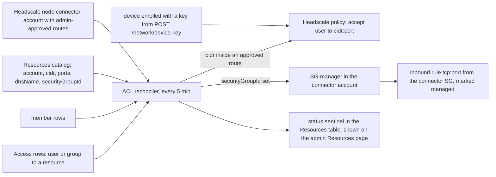

The private network is the portal's optional VPN: Headscale, a self-hosted control plane for standard Tailscale clients, running on Fargate in the hub account, one control plane per site, and one connector task per VPC that enrolls into its site and advertises the VPC's routes. Reachability is not a side effect of holding a role. A user reaches a registered resource only when they hold it under the [[Access Model]], the reconciler has rendered that grant into a Headscale ACL rule, and the resource's security group also admits the connector. Every stack in this area is deployed by hand, never by the pipeline.

## What it is

- A **site** is one routing domain: one Headscale control plane plus the connectors enrolled into it. VPC CIDRs must be disjoint within a site (synth-enforced in `network-validation.ts`); VPCs that collide go in different sites, and a device is connected to one site at a time. The site id is permanent once anything enrolls, because it is the login hostname `<site>.<subdomain>.<zone>`.
- Shared across sites in `NetworkStack`: the VPC, the ECS cluster, one EFS file system (an access point per site; losing a site's directory re-enrolls that site), one internet-facing ALB with a wildcard certificate and wildcard DNS record, and the reconciler.
- Per site: a Headscale Fargate service (Cloud Map `headscale-<site>.tailnet.internal`), an ALB host-header rule at priority 100+ below the `/api/*` 403 block at priority 10 (that band keeps Headscale's admin API off the internet), a connector key minter, and an admin API key secret `<resourcePrefix>/headscale-apikey-<site>` minted by the deploy itself.
- Headscale state is SQLite on EFS with a single writer, so each service runs one task with no rolling overlap.
- Every by-name contract (the minters, the SG-manager, the reconciler role, the secret names, the managed-rule marker) derives from `resourcePrefix`, which is set once before a clone's first deploy and never changed.

Source: [Sites](Private-Network#sites--per-site-control-planes).

## The pieces

| Piece | Runs in | Does |
| --- | --- | --- |
| `NetworkStack` | hub account | The shared VPC, cluster, ALB and EFS; per-site Headscale services, minters and API-key secrets; the ACL reconciler; a Lambda interface endpoint so the reconciler can call SG-managers from a VPC with no internet |
| `ConnectorStack` | the VPC's account, one per VPC | `TailnetConnector` (a Fargate task that mints a key at boot, joins its site as `connector-<account>`, or `connector-<account>-<name>` for an account's named second VPC, and advertises its routes), that VPC's `SgManager` (it converges only its own VPC's groups and answers `other-vpc` for the rest), and a `TailnetResolver` per site |
| `TestbedStack` | hub account, FNTIO-only | A temporary acceptance test bed (nginx and Aurora) with its own SG-manager and resolver |
| Key minter (`keyminter.ts`) | the NetworkStack VPC | The only code that talks to Headscale's admin API, over Cloud Map. `deviceHandler` mints a single-use 30-minute key under `u-<sub>` for a given site and is invocable only by the vending API role. `connectorHandler` (one per site) mints a 5-minute machine key under the `infra` user and ignores its event, so a connector account chooses nothing; which site it joins is decided by which minter it may invoke |
| ACL reconciler (`acl-reconciler.ts`) | the NetworkStack VPC, every 5 minutes and on `POST /admin/network/sync` | Renders effective resource access into one Headscale policy per site; auto-approves private routes of `infra`-owned connectors; detects stale connectors; expires user devices offline 7+ days; prunes replaced connectors; writes the `__reconciler-status__` sentinel with topology |
| SG-manager (`sg-manager.ts`) | each connector account | Converges a resource's security group to "allow tcp on the registered ports from the connector SG"; only touches rules carrying the managed marker; its mutating IAM is pinned to the connector's VPC |
| tailnet-resolver (`resolver.ts`) | each connector VPC, named per site | Names in, IPv4 addresses out; the only path that sees another account's private hosted zones |
| Desktop `tailnet.js` | the user's machine | Drives the locally installed Tailscale CLI |

## From a grant to a reachable port



The rule: a user may reach a resource's `cidr:ports` if and only if they hold it effectively (an own unexpired row or a group bundle) and the resource's CIDR sits inside an admin-approved route of its account's `connector-<account>` node. Everything else is denied by omission. Only admin-approved routes count, never a node's self-advertised ones, so an authenticated user cannot enroll a laptop named like a connector and inject CIDRs. Resources store a CIDR (floor `/24`; a bare IP becomes `/32`) rather than a name because Headscale destinations cannot be DNS names and Aurora failover moves IPs; `dnsName` is re-resolved each pass (a hub-account resource: Cloud Map, then public DNS; any other account's resource: that account's in-VPC resolver, with public DNS as a fallback only for a label the hub's Cloud Map does not own) and the resolved addresses become the rule's destination, so a registered `/32` self-heals. Skipped resources are logged as `no-connector` or `outside-approved-routes`, the first stop for "why can't I reach it?". The policy is PUT whole: a rejected PUT leaves the entire previous policy live, which the `ReconcilerErrors` alarm guards. Revocation lags at most five minutes, plus live WireGuard sessions until rekey.

Reachability is two-keyed: the tailnet route gets a device into the VPC, and each resource's security group must also allow the connector's SG. With `securityGroupId` set on the resource, the SG-manager writes that rule; without it, the rule is a manual step. The reconciler holds no security-group authority itself and may only ask each account's manager, whose resource policy trusts the fixed reconciler role, so `NetworkStack` deploys before any `ConnectorStack`.

Detail: [Resource catalog and per-resource access](Private-Network#resource-catalog--per-resource-access), [ACL reconciler](Private-Network#resource-grants--acl-reconciler-lambdacodenetworkacl-reconcilerts), [SG-manager](Private-Network#per-resource-firewall-automation--sg-manager-lambdacodenetworksg-managerts), [In-VPC DNS resolver](Private-Network#in-vpc-dns-resolver--tailnet-resolver-lambdacodenetworkresolverts), [Tailnet key minting](Private-Network#tailnet-key-minting-lambdacodenetworkkeyminterts), [More security-model notes](Private-Network#more-security-model-notes).

## Dev shares

With `network.devShares.enabled`, a user can share one local port on their laptop with named users or groups on the same site for a bounded time — the "show a teammate my dev server" case, without a staging deploy or a public tunnel. A share is a grant target like a resource (`share#<id>` rows, effective access from the [[Access Model]]) plus a definition row on the fixed `sharedef` principal. Every share row carries the share's expiry (the access model treats an expired row as inactive whoever holds it) and a DynamoDB TTL. The reconciler renders it as `src: u-<grantee>@`, `dst: <owner tailnet IPv4>/32:<port>` from the owner's enrolled devices, and the API kicks a pass on create and stop. The desktop app runs `tailscale serve --http=<port>` so a dev server bound to localhost is reachable; every path that ends the tunnel also ends the serves. Plain HTTP over the encrypted tunnel (Headscale cannot issue the certificate `--https` needs). Owner or admin stops it; grantees get a `SHARE` revocation notice. `GET /network/shares/directory` is the one directory read open to non-admins. Joining a site needs no VPC grant there (the device key is minted for any configured site; the policy decides what a device reaches), so a share can be the only thing a user holds on a site: the Network page groups by network with one Connect per site (a share alone earns a site its group), the desktop pill's chooser lists every site, and a first-time joiner is admitted on the next reconciler pass.

A share can be **bound to one device** (`device`, the device's name on the site): the rule then targets only the IPv4s of the owner's node answering to that name (its DNS name or the hostname it enrolled with), re-resolved on every pass, so a machine that re-enrolls under the same name keeps its shares. A bound share is always open to the owner's own other devices (`src: u-<owner>@`), may name no grantees, and the one-share-per-port rule applies per device. A requested duration above `maxDurationHours` is clamped to it. One user holds at most `maxActiveSharesPerOwner` live shares (default 10).

Detail: [Sharing a local port](https://github.com/FNTIO/aws-infrastructure-client/blob/main/desktop/README.md#sharing-a-local-port-dev-shares).

## My devices

Every machine joined to a site with a user's account is a device of theirs: the desktop app on their computer (one entry per site it has connected to), and any remote development machine or VM enrolled with one of their [[Personal Access Tokens]] (`POST /network/device-key`, optionally `ephemeral: true`, which removes the device 30 minutes after it goes offline). The Network page lists them under **My devices** across every site (`GET /network/devices`), with a **Remove** action (`DELETE /network/devices/{siteId}/{name}`, 404 for anyone else's); in the desktop app the row that is this computer on the active site carries a **this device** badge. A non-ephemeral device that stays offline 7 days is expired by the reconciler. A stale entry keeps its name, so the same machine joining that site again gets a suffixed one; the device-bound share form offers only the devices on the share's site. Detail: [[Personal Access Tokens]] and the package README, [Personal access tokens](https://github.com/FNTIO/aws-infrastructure-client/blob/main/packages/infra-client/README.md#personal-access-tokens).

## Split DNS

`splitDns` lives inside each site (`network.sites.<site>.splitDns`) because overlapping VPCs collide on resolver addresses too. It maps a private domain to that VPC's Amazon resolver (VPC CIDR base + 2); `NetworkStack` renders it into the site's Headscale `dns.nameservers.split`, and every device on that site applies it on connect. Queries for the domain tunnel to the VPC resolver, everything else stays on public DNS, and IPs keep working regardless. Resolution is site-wide, but grants still gate reachability. Names such as RDS endpoints resolve publicly to private IPs and need no entry. Detail: [Split DNS](Private-Network#split-dns-private-names-over-the-vpn).

## The desktop side

`desktop/tailnet.js` drives the locally installed Tailscale CLI; the user installs Tailscale themselves and a guided setup walks them through it on first use. The page obtains a device key from `POST /network/device-key` and passes only the key and a site id over IPC; the control-plane URLs are pinned by the main process from backend discovery and must be `https://`, so a spoofed page cannot redirect the VPN and an unknown site id is refused. Connect is `tailscale login --login-server <site control> --auth-key <key>` followed by `tailscale set --accept-routes`. Each site gets its own Tailscale profile; switching sites tries `tailscale switch` first with a fresh login as fallback, and the active site is derived from the profile's tailnet name. Teardown is scoped: an in-page Disconnect or a backend logout logs out only that backend's profiles, while the tray's Disconnect and Quit are machine-level. CLI failures are classified into stable codes (`not-installed`, `daemon-not-running`, `key-rejected`, `timeout`, `cli-error`). On macOS the Tailscale binary only acts as a CLI when `SHLVL` is set, so the app sets it on every spawn. Detail: [Private network access](https://github.com/FNTIO/aws-infrastructure-client/blob/main/desktop/README.md#private-network-access-epic-4) and [The CLI needs SHLVL](https://github.com/FNTIO/aws-infrastructure-client/blob/main/desktop/README.md#the-cli-needs-shlvl-macos).

## Deploys are manual

`NetworkStack`, `TestbedStack` and `ConnectorStack` are never deployed by the push-to-main pipeline. Deploy them by hand, one at a time: `NetworkStack` with the hub account's profile, each connector with its VPC account's profile (`ConnectorStack` looks the VPC up at synth, so it needs that account's credentials), and `NetworkStack` before any connector so the SG-manager trust resolves. Always pass `--exclusively` (`npx cdk deploy NetworkStack --exclusively --profile <hub>`): without it CDK also deploys the `DataStack` and `CredsStack` dependencies from your local tree and can race the pipeline. Consumer view: [Join a VPC to the VPN](https://github.com/FNTIO/aws-infrastructure-client/blob/main/packages/infra-client/README.md#4-join-a-vpc-to-the-vpn-optional). See also [[Deploy and Upgrade]].

## Runbooks

Each procedure is written once in the deployment README; this list only points at it.

- [Which network runbook do I need?](Runbooks-Network#which-network-runbook-do-i-need): choose between adding a VPC, adding a site, and the one-time migration.
- [Adding a VPC to the network](Runbooks-Network#adding-a-vpc-to-the-network-connectorstack): declare the VPC in its site's config, grant the account on that site's connector minter, deploy `NetworkStack`, deploy `Connector-<account>` into the target account, optionally add split DNS.
- [Adding a SITE](Runbooks-Network#adding-a-site-a-new-control-plane): only when a new VPC's CIDR collides with an existing site; the deploy mints the site's `infra` user and API key.
- [Removing a SITE](Runbooks-Network#removing-a-site): delete the site from config and redeploy; deleting the API-key secret is the one manual step left in the VPN lifecycle.
- [One-time migration: single plane to sites](Runbooks-Network#one-time-migration-single-plane--sites): for a deployment that predates sites; re-enrolls everything once.
- [Headscale admin ops](Runbooks-Network#headscale-admin-ops): ECS Exec per site, API-key rotation with `-c headscaleKeyRotation=<stamp>`, automatic connector pruning.
- SG-manager and resolver rollout for an existing deployment: the ordered `cdk deploy` steps in their sections linked above.

Related: [[Security Posture]] for the Security Hub findings the network stacks raise, [[Troubleshooting]] and [[Runbooks]].

## Sites — per-site control planes

Built 2026-08-12 to the SITES.md plan. A **site** is one routing domain:
one Headscale control plane + the connectors enrolled into it. VPC CIDRs must
be disjoint WITHIN a site (synth-enforced, `packages/infra-client/lib/network-validation.ts`);
genuinely colliding VPCs go in different sites, and a device is connected to
ONE site at a time (the app switches tailscale login profiles). Config:
`network.sites` in `config/project.ts` — the site id is PERMANENT once
anything enrolls (it's the login hostname `<site>.<subdomain>.<zone>`).

Shared across sites: the NetworkStack VPC, ECS cluster, EFS filesystem (one
access point per site — each site's directory re-enrolls that whole site if
lost), one internet-facing ALB with a wildcard cert + wildcard DNS record
(adding a site changes neither), and the reconciler. Per site: the Headscale
Fargate service (Cloud Map `headscale-<site>.tailnet.internal`), an ALB
host-header rule (priority 100+, below the `/api/*` 403 block at 10 — that
band is the security boundary keeping Headscale's admin API off the
internet), a connector key minter, and an admin API key secret
(`<resourcePrefix>/headscale-apikey-<site>`, minted by the deploy itself —
see "Headscale admin ops"). Each site's Headscale sets
`base_domain: <site>.tail.internal` — the desktop shell derives "which site
am I on" from that, with no local bookkeeping to drift.

**Resource prefix:** every by-name contract — the key
minters, `-sg-manager`, the reconciler role, the API-key secret names, and
the `:managed` SG-rule marker — derives from config `resourcePrefix`
(default `infra-client`). It is **SET ONCE, before a clone's first deploy,
then never changed**: renaming later breaks every cross-account by-name
invocation and orphans managed SG rules until all stacks in all accounts
redeploy in lockstep. Max 15 chars (Lambda name budget), synth-validated.

## Tailnet key minting (`lambdacode/network/keyminter.ts`)

The ONLY code path that talks to Headscale's admin API. It runs inside the
NetworkStack VPC and reaches each site's Headscale over private Cloud Map DNS
(`https://headscale-<site>.tailnet.internal:8080`, verified against the
certificate the site's task publishes to SSM `/<resourcePrefix>/headscale-tls-<site>`
at every start — self-signed, so authenticated by IAM, not a CA); the admin API is
403-blocked at the public ALB, so key minting is impossible from the internet
even with a stolen API key (per site, minted by the server container at
start and stored by `Custom::HeadscaleApiKey`). The key
itself is valid for 10 years and a rotation does not revoke its predecessor,
so expire a leaked one via ECS Exec (`headscale apikeys expire`, see
[Headscale admin ops](Runbooks-Network#headscale-admin-ops)).

Handlers with SEPARATE invoke permissions — this split is the security
boundary:

- **deviceHandler** (one for all sites) — takes a `siteId` and mints a
  single-use 30-minute key enrolling a device under a SPECIFIC Headscale user
  (name = `u-<Cognito sub>`, see `lambdacode/network/naming.ts` — Headscale
  500s on names starting with a digit, and about half of all subs do; the
  reconciler shares the same mapping). Invocable ONLY by the vending API
  role, which binds `userName` to the JWT-verified sub and validates the
  siteId. Never granted to connector/target accounts. A siteId argument is
  SAFE here (users legitimately enroll into every site they hold grants in).
  Migration note (2026-08-06): users enrolled before the `u-` prefix hold
  devices under raw-sub Headscale users; they must Disconnect + Connect once,
  and the orphaned raw-sub users/nodes age out (7-day device expiry) or can be
  deleted via ECS Exec (`headscale users destroy …` — also remove the
  leftover `debug-delete-me` test user).
- **connectorHandler** (ONE PER SITE, env-pinned to its site's control
  plane) — mints a 5-minute machine key (redeemed at container boot) under
  the fixed machine-owner user (`HEADSCALE_USER_ID`, default `1`). It ignores
  its event entirely, so a cross-account connector principal cannot influence
  which identity it enrolls as — or WHICH SITE it enrolls into: site
  selection rides on which minter an account may invoke
  (`site.connectorAccounts`), never on an argument. That's what makes
  granting target accounts invoke on this handler (and never the device one)
  safe.

Key expiry bounds the *unredeemed credential*, not the session — enrolled
devices stay enrolled.

`POST /network/device-key` lets ANY signed-in user enroll; per-user
reachability is enforced by the ACL reconciler below, not at enrollment. Every
mint is an audit row (`action: NETWORK_KEY`). With `ephemeral: true` the key is
an ephemeral one: Headscale deletes the node after 30 minutes offline
(`ephemeral_node_inactivity_timeout`) instead of the reconciler expiring it
after 7 idle days. The device handler also answers `op: "list"` (the caller's
nodes on every site, for `GET /network/devices`; a site whose control plane
does not answer is named in `unreachable` instead of failing the list) and
`op: "delete"` (the one node listed under that name on one site — never a
lookalike, so removing a stale duplicate leaves the re-enrolled machine
alone); both act only on the `u-<sub>` user the API bound, so they reach
nobody else's devices.

## Resource catalog & per-resource access

AWS role access (control plane: console, APIs) and network access (data plane:
actually querying a DB, opening an internal site) are **separate permission
systems** as of 2026-07-31. A role grant no longer opens any VPC; VPN
reachability comes only from effective resource access (own grant or a
group bundle — access model v2) on admin-registered catalog
entries, one `cidr:port` at a time. The old behavior (any role grant in an
account → that account's whole VPC) was replaced, not kept alongside — two
overlapping systems would make per-resource grants meaningless for anyone
holding a role.

**How much one site holds:** the access rules for a site are one document, and
the control server refuses a document over 4 MB (a refused update leaves the
old rules live, so grants and revocations stop applying). One user holding one
resource costs about 95 bytes, which puts a site at roughly 40,000
user-resource pairs: 1,000 users with 40 resources each. The reconciler logs a
warning at three quarters of the limit and fails the site's pass with the size
in the error above it. Past that, grant through fewer, wider resources (a
subnet range in place of many single hosts) or split the VPCs across sites.

**Why resources store a CIDR, not a bare IP:** Headscale ACL destinations
cannot be DNS names, and Aurora failover moves the writer to a different
instance IP in the same subnets. Registering the DB-subnet range (e.g. a
`/24`) keeps access working across failover; a bare IP input is normalized to
`/32`. The widest range accepted is `/16`, the largest VPC AWS allows; the
reconciler's containment check (below) is the real gate, and the form states
how many addresses a range wider than `/24` covers. `dnsName`,
when set, is re-resolved each pass and the resolved addresses become the
rule's destination (see the reconciler below); users connect by it via split DNS.
For a named resource the range itself never becomes a rule: it only says which
VPC the resource lives in.

**Cutover note:** deploying this NetworkStack change is the switch — from the
next 5-minute pass, users need resource grants for any reachability. Register
resources + grant users (admin → Resources) before or right after.

## Resource grants → ACL reconciler (`lambdacode/network/acl-reconciler.ts`)

Rule: a user may reach a resource's `cidr:ports` **iff they hold it effectively
(own unexpired Access row, or a group they are in bundles it) AND the resource's cidr sits inside an
admin-approved route of its account's `connector-<account>` node**.

- Access (effective resource access, one scan) + Resources tables (fine at their scale) →
  grantees per resource; Headscale nodes named `connector-<account>` → that
  account's **approved** routes. One accept rule per (user, resource) whose
  cidr is fully contained in an approved route; dst = `cidr:port` per
  registered port; everything else is denied by omission. The containment
  check stops a bad catalog entry from opening address space the connector's
  admin never approved — skipped resources are logged with a reason
  (`no-connector` / `outside-approved-routes`), which is the first stop for
  "why can't I reach it?".
- Rendered as one Headscale policy (mode: database) and PUT via the admin API.
  Runs on a schedule (and on demand); a user whose grant expired loses the
  network on the next pass.
- ONLY admin-approved routes are honored — never a node's self-advertised
  `subnetRoutes`. Otherwise an authenticated user could enroll a node named
  `connector-<account>` and inject CIDRs into other grant-holders' policy.
  Route approval stays the deliberate admin gate.
- Gotcha (seen live 2026-07-29): when a connector task re-enrolls while its
  predecessor's node still exists, Headscale dedupes the name to
  `connector-<account>-<random>`; the reconciler matches the account digits
  with an optional suffix (and unions approvals across duplicates), because a
  plain prefix-strip made every rule for that account silently vanish.
- **Approving routes is the trust gate — verify the node ID, not the name,**
  before `headscale nodes approve-routes`: device names are client-chosen, so
  any user could enroll a laptop named `connector-<account>-x`. Only the
  admin approval makes routes count.
- Freeze semantics: the policy is PUT whole; a rejected PUT leaves the
  ENTIRE previous policy live (revocations included) until a pass succeeds —
  that's what the ReconcilerErrors alarm guards. The reconciler therefore
  filters out anything Headscale would reject: grants to users who never
  enrolled a device (`usersNotEnrolled` in the log; they get their rules on
  the pass after first connect), rows with no valid ports, and malformed
  expiries (treated as expired, never permanent).
- Known limit (accepted): rare partial-failure races (delete-resource
  cascade vs concurrent group edits, GSI lag) can leave orphan `resource#`
  rows in the Access table. They are inert in ACLs when their catalog row is gone (the reconciler
  joins against the catalog) and show as "(deleted resource)" in the admin
  UI; retrying the failed admin action heals the rest.
- Same placement as the key minter: inside the NetworkStack VPC (Cloud Map to
  Headscale, DynamoDB via the VPC gateway endpoint — no internet).
- **Ops duties riding each pass** (all fail-soft): re-resolution of resource
  dnsNames — for a hub-account resource, Cloud Map first (Fargate IP drift; its
  registry knows a replaced task before DNS TTLs expire), then plain DNS; for
  any other account's resource, that account's in-VPC `tailnet-resolver` (see
  its section below; the only path that sees ANOTHER account's private zones),
  then plain DNS only when the hub's Cloud Map has no service by that label —
  the hub's view is never asked for another account's private name, since a
  same-named service in both (dev and prod `litellm.<ns>.internal`) would hand
  the dev resource the prod task's address. Plain DNS covers RDS/Aurora
  endpoints, which resolve publicly to their CURRENT private IP, so a
  registered /32 self-heals across failover (works despite no internet — the
  VPC resolver recurses public zones itself); resolved IPs are still
  containment-checked. Each
  granted dnsName resource's sentinel entry records which address the rules
  used — `addr: "dns"` + `addrIp`, or `"dns-stale"` (unresolvable: the rules
  hold the addresses the name last resolved to, for up to 24 hours after it
  last resolved; after that or with none on record the resource is skipped as
  `dns-unresolved` — the stored range is never the fallback, so a failure
  cannot widen what a grant reaches) — rendered on the admin Resources page as
  "Follows DNS" / "DNS unresolved". Also: auto-approval of a connector's private
  advertised routes when the node is owned by the `infra` machine user (the
  identity only the connector minter can create — impostor names get
  nothing), stale-connector detection (OFFLINE 15+ min with approved routes →
  `StaleConnectors` EMF metric → alarm; recovery = force-new-deployment, the
  replacement's routes auto-approve), device-key hygiene (USER devices
  offline 7+ days are expired via `POST /node/{id}/expire` — must re-Connect
  in the app; never `infra`/connector nodes, and idle-based on purpose:
  Headscale has no future-expiry setter, and enrollment-age expiry would
  loop). Both checks gate on the API's `online` flag, never `lastSeen` alone —
  Headscale writes `lastSeen` on *disconnect*, so a continuously-connected
  node's `lastSeen` freezes at enrollment (false-alarmed 18h live
  2026-08-03→04 while the network worked fine). Finally, a status summary is
  written as the `__reconciler-status__` sentinel item in the Resources table
  (the VPC has no internet; the DynamoDB gateway endpoint is the only free
  egress) and powers the admin Resources page's Status badges + sync banner.
  Since 2026-08-17 the same row also carries a `topology` block — every
  `connector-<account>` node the pass saw (`trusted` = `infra`-owned,
  online/lastSeen, advertised vs approved routes) and per-user device state
  (`devices[<sub>]`: unexpired count, online, lastSeen) — which
  `GET /admin/network` merges across sites for the admin Network map. Display
  only; the ACLs above stay the sole access decision. Devices also drop at session end: the desktop app runs
  `tailscale logout` on app logout/quit when — and only when — the tunnel
  was brought up by the app itself.

## Per-resource firewall automation — SG-manager (`lambdacode/network/sg-manager.ts`)

The second door of two-keyed reachability, automated. A resource may
optionally carry a `securityGroupId` (admin UI → Register/Edit resource); each
reconciler pass then converges that group to "allow tcp:<registered ports>
FROM the connector's SG" — the manual EC2-console inbound-rule step disappears
for those resources. Resources **without** the field keep the manual step:
open the resource's SG to the connector SG (the `ConnectorSecurityGroupId`
stack output) by hand, or the app shows connect commands that silently time
out.

How it works / why it's shaped this way:

- A small **SG-manager Lambda lives in each connector account**
  (`infra-client-sg-manager`, deployed by ConnectorStack — and TestbedStack
  for the main account; never point ConnectorStack at the account running
  TestbedStack, both pin the same function name and the deploy fails). The
  central reconciler holds **no security-group authority anywhere**; it may
  only *ask* each account's manager, whose mutating IAM is pinned to the
  connector's VPC (`ec2:Vpc` condition — resources in a *peered* VPC can't
  use the automation). Rules it writes are always `tcp`, single-port,
  source = connector SG (from env, never caller input).
- **Ownership marker:** every rule the manager writes carries the description
  `infra-client:managed`, and it only ever *revokes* rules carrying it. Hand-
  written and CDK-created rules (the testbed's) are never touched — and the
  inverse: don't hand-edit a managed rule (changing its port range/protocol
  in the console orphans it from cleanup while keeping the door open; delete
  it instead and let the next pass recreate it). Clearing a resource's
  `securityGroupId` (or deleting the resource) removes the managed rules on
  the next pass — accounts that ever held managed rules are remembered in the
  status sentinel (`sgAccounts`), so the sweep still reaches an account whose
  *last* SG-carrying resource is gone.
- **Trust:** the reconciler runs as the fixed-name role
  `infra-client-acl-reconciler`; each SG-manager's resource policy allows
  exactly that ARN (key-minter pattern, inverted — the trusted account is A).
  Lambda resolves the principal when the permission is attached, so **deploy
  NetworkStack before ConnectorStack**, and redeploy every ConnectorStack if
  that role is ever recreated (symptom: `Firewall sync failed` badges).
- SG sync runs **after** the Headscale policy PUT and is entirely fail-soft —
  a broken/missing SG-manager can never freeze ACL sync. Grants play no part:
  the rule admits the *connector*; per-user reachability stays with the ACLs
  (so the rule exists even while no one is granted, letting an admin verify
  connectivity right after registering).
- Per-resource outcome lands in the `__reconciler-status__` sentinel (`sg`:
  `ok` / `not-found` / `invalid` / `error` / `other-vpc` / `sg-sync-failed`) and shows as a
  second badge on the admin Resources page. `other-vpc` = the group sits in none of
  the account's connector VPCs — register the resource in the right account, or add
  that VPC to `connectorVpcs`. `sg-sync-failed` = the invoke
  itself failed — usually a ConnectorStack that predates the SG-manager, or
  the recreated-role case above.
- The reconciler's VPC has no internet, so NetworkStack adds a **Lambda
  interface endpoint** (one ENI, ~$8/mo — same pattern as the Cloud Map one).

Rollout for an existing deployment (one-time, manual — Epic 4 rules):

```sh
# 1. main account — new reconciler role + Lambda endpoint:
npx cdk deploy NetworkStack --exclusively --profile main
# 2. main account — testbed's own SG-manager (only while the testbed exists):
npx cdk deploy TestbedStack --exclusively --profile main
# 3. each connector account (VPC id + routes come from config) — adds that
#    account's SG-manager + trust:
npx cdk deploy Connector-<acct> --exclusively --profile <that account's profile>
```

Then set **Security group ID** on a resource (EC2 console → the
instance/database → Security tab → its SG id) and watch for the green
`Firewall auto` badge after the next 5-minute pass.

## In-VPC DNS resolver — tailnet-resolver (`lambdacode/network/resolver.ts`)

One per connector VPC (auto-included in `ConnectorStack` and the testbed),
same by-name cross-account trust as the SG-manager (resource policy pinned to
the fixed reconciler role) — but named PER SITE
(`<prefix>-tailnet-resolver-<siteId>`), because one account may host connector
VPCs in two sites and each VPC has its own private-DNS view; the reconciler's
IAM covers them with a `…-tailnet-resolver-*` wildcard. Names in, IPv4s out —
it makes no AWS API calls,
so it runs in the VPC's public subnets with no NAT or endpoints (DNS comes
from the VPC resolver). It exists because private zones are invisible outside
their VPC: without it, dnsName drift-healing silently failed for every
non-hub site (seen live 2026-09-02: the sandbox nginx task had restarted
Aug 26, DNS followed the new IP, the ACL kept authorizing the dead one —
"No answer" for a week while everything looked healthy). Rollout for an
existing deployment (one-time, manual — Epic 4 rules): `cdk deploy`
NetworkStack (reconciler + invoke IAM) first, then each ConnectorStack and
TestbedStack (adds the fn). A named resource in an account without the resolver
has no rules until its name resolves, flagged "DNS unresolved" on the admin
Resources page.

Connector VPCs in another region (`connectorVpcs.<account>.region`): the
SG-manager and resolver deploy with the connector, in the VPC's region, but
the reconciler sits in the hub VPC with no internet path and a Lambda endpoint
for the hub region only — and Lambda refuses a foreign-region function ARN at
another region's endpoint. NetworkStack therefore adds a small relay function
outside the VPC, on its own invoke-only role
(`<prefix>-acl-reconciler-relay`, created on every hub); a connector in
another region pins its SG-manager's and resolver's trust to that role instead
of the reconciler's, and the reconciler forwards those accounts' invokes
through the relay, which addresses only the account→region pairs from config
and the two well-known function names. The boundary is who may invoke the
relay in the hub account — the reconciler role alone. The reconciler remembers
each foreign account's region in its status sentinel so a departed account is
still swept while its region is configured; afterwards it is logged once and
dropped (rules to revoke by hand — see the network runbook). The connector's
key-mint sidecar runs in the minter's region for the same endpoint reason.

## Images from your own registry

By default the control-server and connector tasks pull the Headscale and
Tailscale images from GitHub's public registry every time a task starts. A
running task is unaffected by that registry, but a restart or a replacement
while it is unreachable or rate-limiting cannot start.

`network.mirrorImages: true` (hub) and the `mirrorImages` prop on
`ConnectorStack` / `TailnetConnector` (each connector account) change that: the
deploy copies the pinned image once into a private registry in the same
account, and tasks start from the copy. The public registry is then needed
only while deploying, where a failure is a visible, retryable rollback.

- The copy runs in a deploy-time function (`cdk-ecr-deployment`); no Docker
  is needed on the deploying machine and the public images need no
  credentials. It copies the `amd64` variant, which is what the tasks run on.
- The deploying project installs the copy tool itself
  (`npm install cdk-ecr-deployment`); deployments that leave the option off
  install nothing extra.
- Each registry has scan-on-push and a keep-five cleanup rule (Security Hub
  ECR.1, ECR.3) and is deleted with its stack. Tags are left overwritable on
  purpose, so Security Hub lists ECR.2 for each registry: a rollback re-runs
  the copy onto a tag that already exists, and a locked tag there could strand
  the stack mid-rollback.
- Turning the option on or off changes each task's image address, so every
  control server and connector it applies to restarts once. A connector
  restart leaves its VPC unreachable until the next reconciler pass (up to
  five minutes). Deploy `NetworkStack` first, then one connector stack at a
  time.
- Proven on the dev deployment on 2026-10-06 (hub and sandbox connector): the copy
  pulled both images from GitHub without credentials, each control server and
  the connector restarted once, and access worked afterwards. Only the removed
  connector's old node remains until the reconciler prunes it after 24 hours.

## More security-model notes

- **Sites review notes (2026-08-12):** (1) route
  auto-approval was bounded to RFC1918 but not to a connector's DECLARED
  ranges, so a trusted connector could advertise another account's subnet in
  its site and receive that traffic. Closed in 0.2.0: in a site that lists
  any `connectorVpcs`, a route is approved only inside the `routes` declared
  for that connector's own VPC, and a connector matching no entry gets none
  (its node name, account included, is its own choice). A site that lists no
  `connectorVpcs` keeps the private-range rule. Routes approved before the
  upgrade that fall outside a declaration are logged every pass, not removed
  (removing them on a config slip would drop a working VPC): check each
  connector's approved routes on the admin Network map against config once
  after upgrading.
  (2) The device minter + reconciler hold ALL sites' Headscale admin keys in
  one env var — same trust boundary as before (account-A IAM), broader blast
  radius per function. (3) With >5 sites, revisit the reconciler timeout vs
  its 5-minute schedule (overlapping passes).

- **Reconciler freshness:** grants render into Headscale ACLs every 5 minutes,
  so revocation lags ≤5 min (plus live WireGuard sessions until rekey) — same
  freshness class as vended credentials. A broken reconciler silently freezes
  reachability *including revocations*; the alarm fires on 2+ consecutive
  failures.
- **Two-keyed reachability:** a tailnet route gets you INTO the VPC, but each
  resource's security group must additionally allow the connector's SG —
  automated per-resource via `securityGroupId` + the SG-manager (above),
  manual for resources without the field.
- **Headscale state is SQLite on EFS:** one writer only — the service is pinned
  to a single task (min 0% / max 100%, no rolling overlap); losing the EFS
  re-enrolls every device.

## Split DNS (private names over the VPN)

`splitDns` lives INSIDE each site (`network.sites.<site>.splitDns`:
overlapping VPCs collide on resolver IPs too, so it can't be global)
and maps a private domain to its VPC's Amazon resolver (VPC CIDR base + 2);
NetworkStack renders it into that site's Headscale `dns.nameservers.split`,
and every device ON THAT SITE applies it automatically on (re)connect —
queries for that domain tunnel to the VPC resolver, everything else stays on
public DNS. Onboarding a client's internal names = one config entry (their
domain → their resolver IP) + NetworkStack redeploy; no client-side DNS or
firewall work (resolver queries bypass security groups). IPs keep working
regardless — DNS is additive. Resolution is site-wide, but grants still gate
reachability (ACL reconciler). The testbed nginx is registered via Cloud Map
as `nginx.testbed.internal` (record follows task restarts); note names like
RDS endpoints resolve publicly to private IPs and need no split entry.
